# EKS Cluster with Node Group and Auto Scaling

## Description

This project builds a working Kubernetes environment on AWS EKS using the AWS console and CLI. It sets up the IAM roles, a dedicated VPC created with CloudFormation, the EKS control plane, and a managed worker node group. It then adds automatic node scaling with the Kubernetes Cluster Autoscaler, which authenticates to AWS through an OIDC identity provider and an IAM role. Finally, it deploys a sample Nginx app and exposes it to the internet through a LoadBalancer service.

**Environment:** region `eu-central-2`, Kubernetes version 1.37

## Technologies used

Kubernetes, AWS EKS, AWS IAM, AWS CloudFormation, AWS EC2 and Auto Scaling, OIDC, Cluster Autoscaler, Nginx, AWS CLI, kubectl

## Prerequisites

- AWS account with permissions for IAM, EKS, EC2 and CloudFormation
- AWS CLI installed and configured (`aws configure`)
- `kubectl` installed

> **Cost warning:** the EKS control plane costs about $0.10/hour, plus the EC2 instances and the load balancer. Follow the [Cleanup](#cleanup) section when you are done.

---

## Steps

### 1. Create the EKS cluster IAM role

This role lets AWS manage and create cluster components on your behalf.

- IAM → Roles → Create role
- Trusted entity: **AWS service**, use case: **EKS → EKS - Cluster**
- Keep the suggested permission policy (`AmazonEKSClusterPolicy`)
- Role name: `eks-cluster-role`

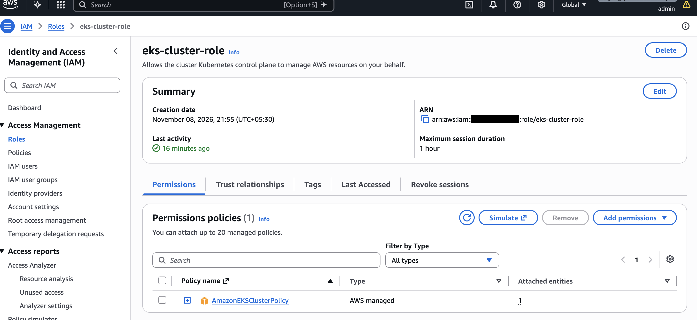

### 2. Create a VPC for the worker nodes

The default VPC is not suited for EKS. Worker nodes need a specific networking and firewall setup with public and private subnets (the load balancer is placed in the public subnets). Instead of building it by hand, use the official AWS CloudFormation template:

```
https://s3.us-west-2.amazonaws.com/amazon-eks/cloudformation/2020-10-29/amazon-eks-vpc-private-subnets.yaml
```

Reference: <https://docs.aws.amazon.com/eks/latest/userguide/creating-a-vpc.html>

- CloudFormation → Create stack → choose an existing template → Amazon S3 URL (above)
- Stack name: `eks-worker-node-vpc-stack`
- Default CIDR blocks
- Submit

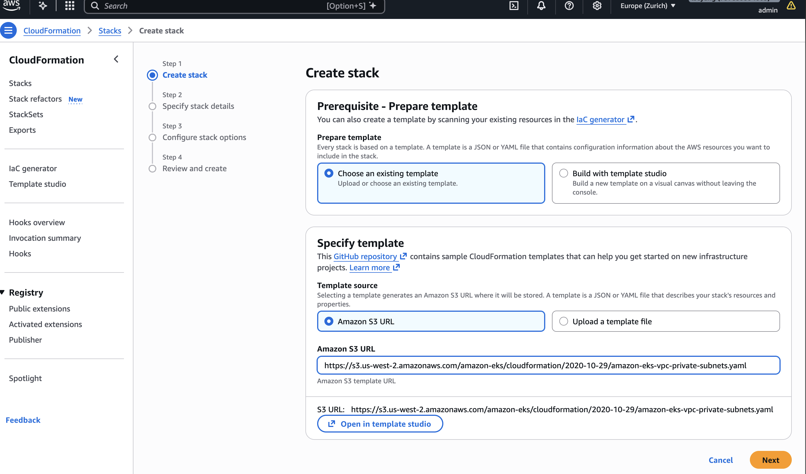

Wait until the stack status is `CREATE_COMPLETE`.

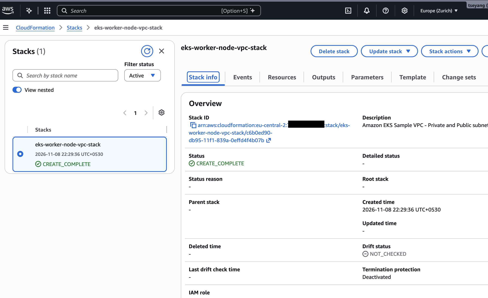

Open the stack's **Outputs** tab. You need the **security group**, **VPC ID** and **subnets** in the next step.

### 3. Create the EKS cluster (control plane)

Amazon EKS → Create cluster → **Custom configuration**

- **Name:** `eks-cluster-test`
- **Cluster IAM role:** `eks-cluster-role`
- **Cluster authentication mode:** EKS API and ConfigMap
- **VPC / subnets / security group:** from the `eks-worker-node-vpc-stack` outputs (the VPC and all 4 subnets: 2 private, 2 public)
- **Cluster endpoint access:** Public and private
- **Add-ons:** default add-ons

Click **Create cluster**. It becomes active after about 10–15 minutes.

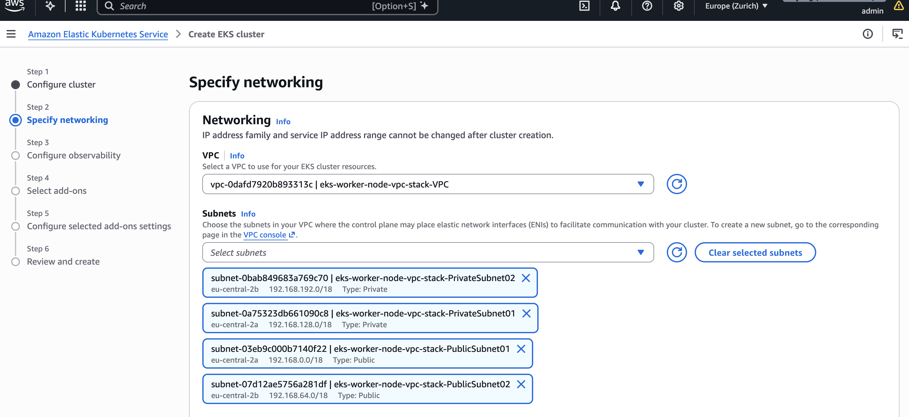 <br><br><br><br> 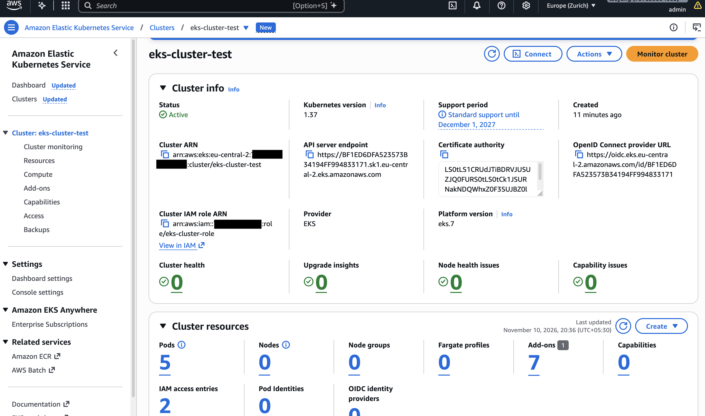

### 4. Connect kubectl to the cluster

```bash
aws configure list
aws eks update-kubeconfig --name eks-cluster-test
kubectl cluster-info
kubectl get nodes
```

`update-kubeconfig` adds the cluster to your local kubeconfig. `kubectl cluster-info` should show the same API server endpoint as the console. `kubectl get nodes` returns nothing yet because there are no worker nodes.

My default region is `eu-central-2`. If your default region is not set, add `--region`.

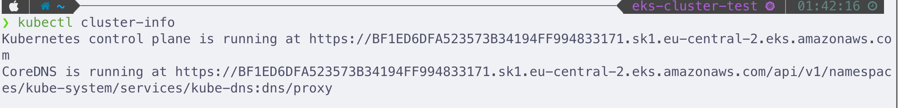

### 5. Create the node group IAM role

The kubelet on each worker node (EC2 instance) needs permissions through an IAM role.

- IAM → Roles → Create role → use case **EC2**
- Attach these policies:
   - `AmazonEKSWorkerNodePolicy` – lets nodes connect to EKS
   - `AmazonEC2ContainerRegistryReadOnly` – pull images from ECR
   - `AmazonEKS_CNI_Policy` – networking between pods/nodes and other AWS services
- Role name: `eks-node-group-role`

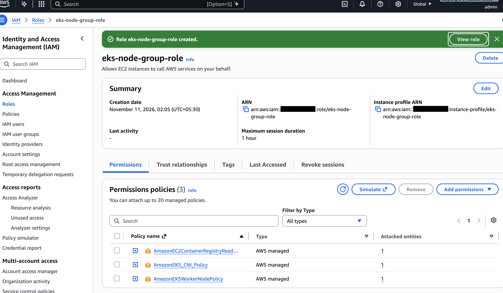

### 6. Create the node group

EKS → Clusters → `eks-cluster-test` → Compute → **Add node group**

- **Name:** `eks-node-group`
- **Node IAM role:** `eks-node-group-role`
- **AMI type:** Amazon Linux 2023 (standard)
- **Capacity type:** On-Demand
- **Instance type:** `t3.small`
- **Disk size:** 20 GiB
- **Scaling (desired / min / max):** 2 / 2 / 2 (changed later in step 7.6)
- **Subnets:** the 4 subnets from the VPC stack (fine for a demo; for production, use private subnets only)
- **Remote access:** enabled, with an EC2 key pair (used for testing and troubleshooting; disable in production)

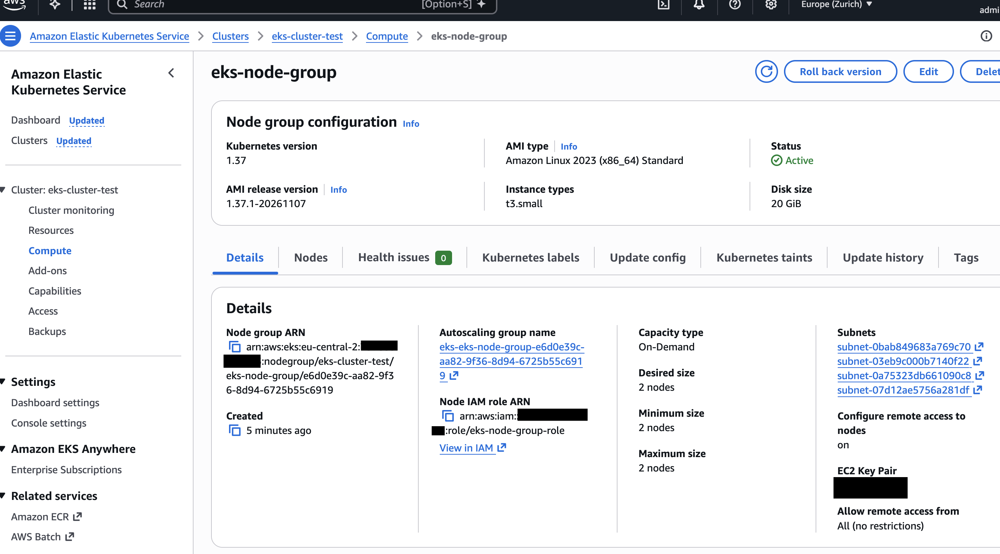

When the node group is active, the EC2 instances join the cluster:

```bash
kubectl get nodes     # shows the 2 worker nodes
```

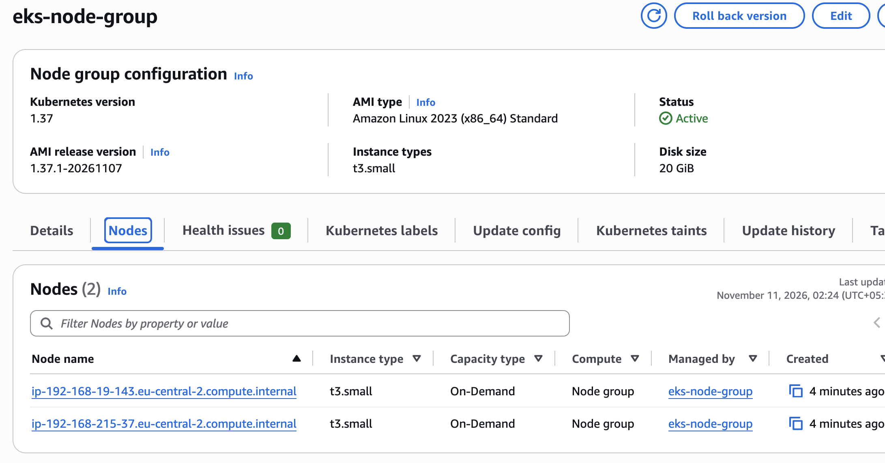

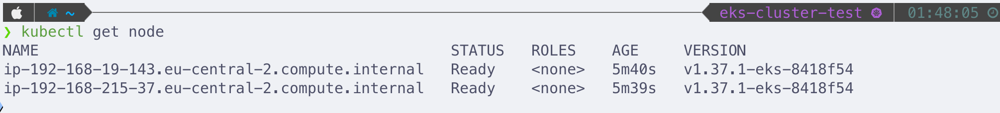

An Auto Scaling Group is created automatically for the node group:

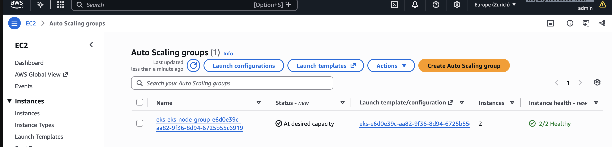

### 7. Configure auto scaling

The node group creates an **AWS Auto Scaling Group**, but AWS does not scale the instances based on Kubernetes workloads. The Kubernetes **Cluster Autoscaler** works together with the Auto Scaling Group to add and remove nodes.

**How authentication works**

The Cluster Autoscaler calls the AWS API to add and remove instances. It runs with its own Kubernetes ServiceAccount, and the IAM role only accepts that ServiceAccount.

```
K8s ServiceAccount token (JWT) → AWS STS (Web Identity) → Temporary AWS credentials → EC2 / Auto Scaling API actions
```

Trust between Kubernetes and AWS is created with **OIDC (OpenID Connect)**. This approach is called IRSA (IAM Roles for Service Accounts). EKS Pod Identity is a newer alternative.

#### 7.1 Create the custom IAM policy

IAM → Policies → Create policy (JSON editor), name: `ClusterAutoscalerPolicy`

The policy allows the EC2 (list) and EC2 Auto Scaling (list, write) API calls the autoscaler needs.

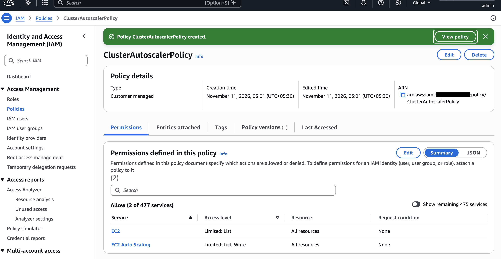

#### 7.2 Register the EKS OIDC provider in IAM

- EKS → `eks-cluster-test` → copy the **OpenID Connect provider URL** (shown in the cluster info in step 3)
- IAM → Identity providers → Add provider → **OpenID Connect**
- Paste the provider URL
- Audience: `sts.amazonaws.com`
- Create provider

#### 7.3 Create the IAM role for the ServiceAccount

- IAM → Roles → Create role → **Web identity**
- Choose the OIDC provider created above
- Attach `ClusterAutoscalerPolicy`
- Role name: `EKSServiceAccountRole`

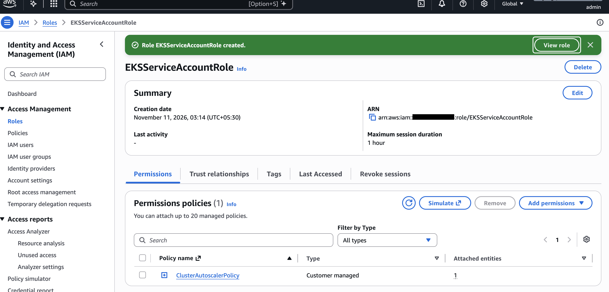

#### 7.4 Check the Auto Scaling Group tags

The autoscaler finds the Auto Scaling Group through tags. EKS adds them to the managed node group's Auto Scaling Group; check that these two exist:

| Key | Value |
|-----|-------|
| `k8s.io/cluster-autoscaler/enabled` | `true` |
| `k8s.io/cluster-autoscaler/eks-cluster-test` | `owned` |

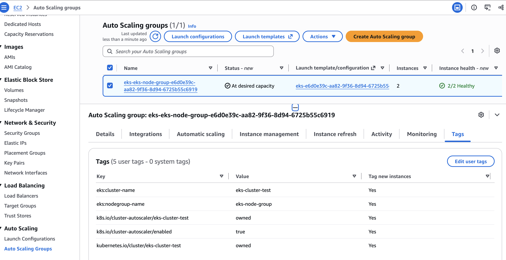

#### 7.5 Deploy the Cluster Autoscaler

Edit `cluster-autoscaler.yaml`:

- **ServiceAccount:** add an annotation with the ARN of `EKSServiceAccountRole`
- **Image version:** must match the Kubernetes version of the cluster (1.37 here). Find the tag at <https://github.com/kubernetes/autoscaler/tags>
- **Environment variable:** set the AWS region (`eu-central-2`)
- **Pod annotation** (`spec.template.metadata.annotations`):
  ```yaml
  cluster-autoscaler.kubernetes.io/safe-to-evict: "false"
  ```
  This prevents the autoscaler from evicting itself when scaling down.

```bash
kubectl apply -f cluster-autoscaler.yaml
kubectl get deployment -n kube-system cluster-autoscaler
kubectl get pod -n kube-system
```

The Cluster Autoscaler pod should be running in the `kube-system` namespace.

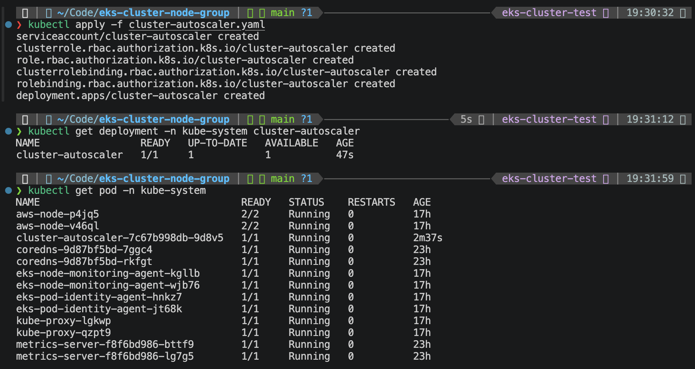

Check the logs to confirm it discovers the Auto Scaling Group. At this point the node group is at its minimum size (2), so scale-down is skipped:

```bash
kubectl logs -n kube-system deployment/cluster-autoscaler
```

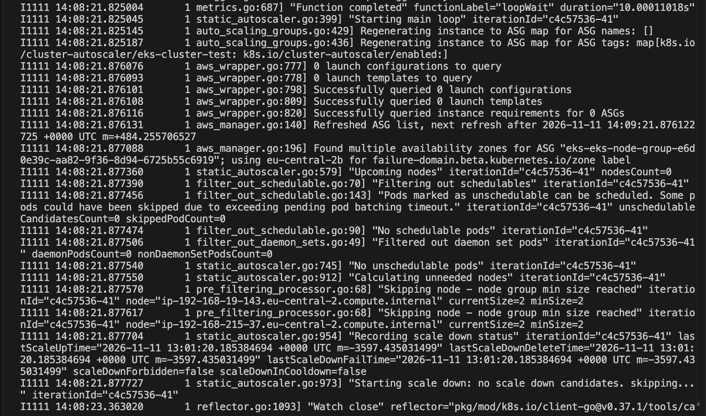

#### 7.6 Change the node group scaling limits

With min = max = 2, the autoscaler has no room to scale. Before testing, edit the node group scaling configuration:

EKS → `eks-cluster-test` → Compute → `eks-node-group` → Edit → **Scaling configuration**

- **Minimum size:** 1
- **Desired size:** 2
- **Maximum size:** 3

#### 7.7 Test it

A `t3.small` node supports only a small number of pods (around 11), so a few extra replicas fill the nodes quickly.

**Scale up:** increase the replicas until some pods stay `Pending` because the nodes are full. This triggers the autoscaler to add a node (a new EC2 instance takes a few minutes).

```bash
kubectl scale deployment nginx --replicas=20
kubectl get pods
```

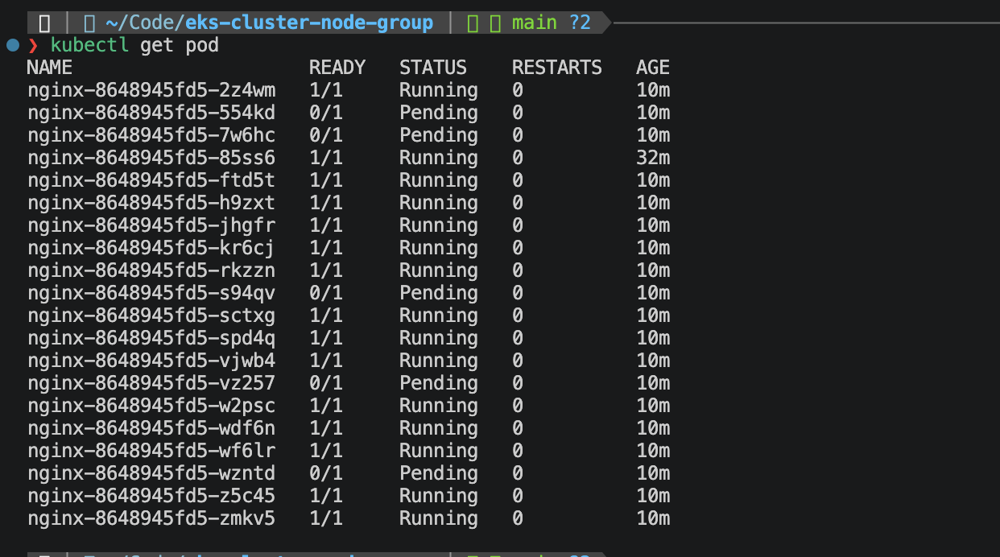

**Scale down:** reduce the replicas again. The extra node is no longer needed and the autoscaler removes it.

```bash
kubectl scale deployment nginx --replicas=1
kubectl get pods
```

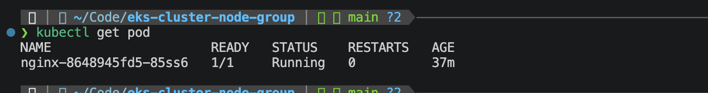

### 8. Deploy a sample app

`nginx.yaml` contains an Nginx deployment and a service of type `LoadBalancer`.

```bash
kubectl apply -f nginx.yaml
kubectl get pod       # nginx pod is running
kubectl get svc       # shows the external DNS name
```

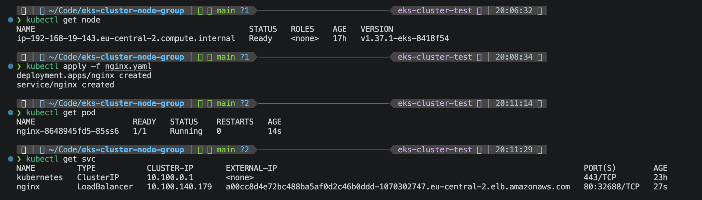

A load balancer is created automatically for the `LoadBalancer` service. Its DNS name matches the external address shown by `kubectl get svc`. Open it in your browser to access the app.

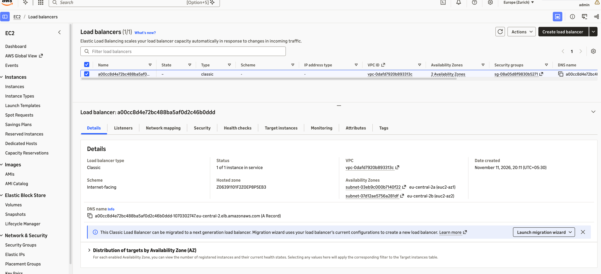

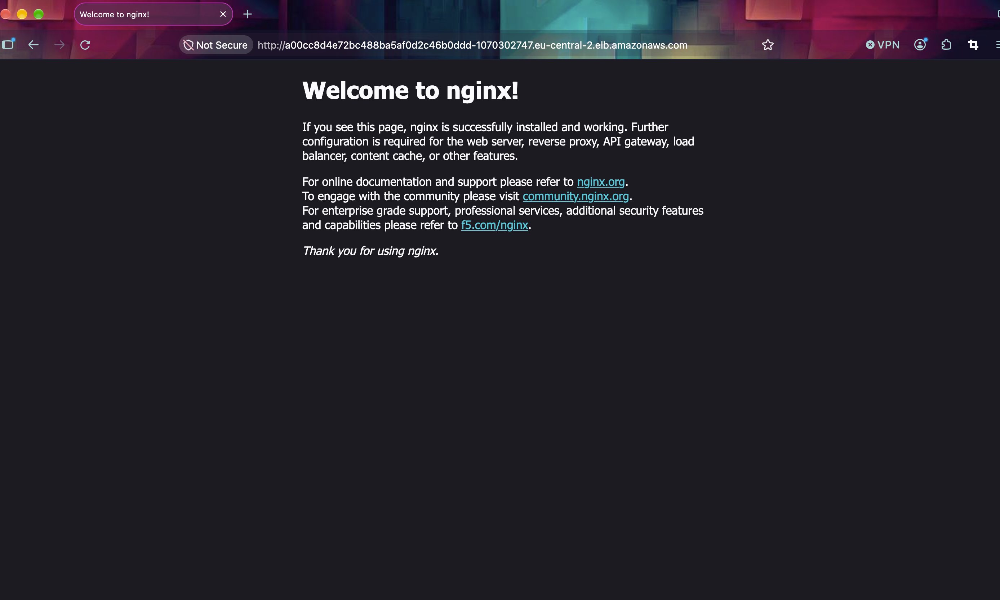

---

## Cleanup

Delete the resources in this order to avoid ongoing costs:

1. Nginx app and load balancer: `kubectl delete -f nginx.yaml`
2. Cluster Autoscaler: `kubectl delete -f cluster-autoscaler.yaml`
3. Node group
4. EKS cluster
5. CloudFormation stack (`eks-worker-node-vpc-stack`)
6. OIDC provider
7. IAM roles (`EKSServiceAccountRole`, `eks-node-group-role`, `eks-cluster-role`) and `ClusterAutoscalerPolicy`

> Wait until the load balancer is fully gone before deleting the stack. Leftover network interfaces (ENIs) can make the stack deletion fail.